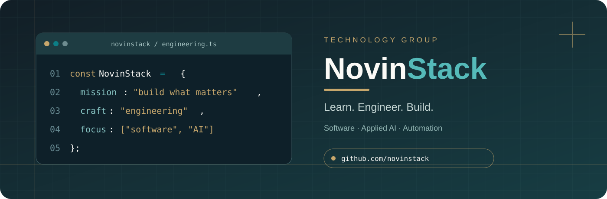
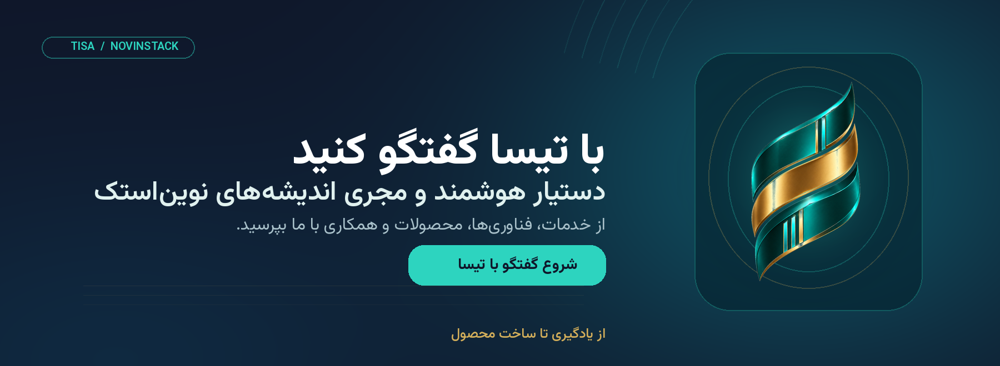
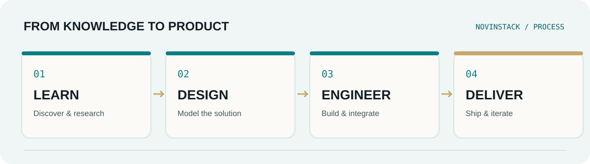

<h1 dir="rtl" align="center">NovinStack | نوین‌استک</h1>

<strong>گروه نرم‌افزاری و فناوری نوین‌استک</strong> از یادگیری تا ساخت محصول · From Knowledge to Product

  

  <strong>🇮🇷 فارسی</strong> &nbsp;·&nbsp;
  <a href="./README_EN.md"><strong>🇬🇧 English</strong></a>

  <a href="https://novinstack.com">وب‌سایت رسمی</a> &nbsp;·&nbsp;
  <a href="https://github.com/novinstack?tab=repositories">مخازن و پروژه‌ها</a> &nbsp;·&nbsp;
  <a href="https://www.linkedin.com/company/novinstack/">لینکدین</a> &nbsp;·&nbsp;
  <a href="https://www.instagram.com/novinstack/">اینستاگرام</a> &nbsp;·&nbsp;
  <a href="https://t.me/novinstack">تلگرام</a> &nbsp;·&nbsp;
  <a href="https://www.youtube.com/@NovinStack">یوتیوب</a>

---

<h2>درباره نوین‌استک</h2>

<strong>نوین‌استک (NovinStack)</strong> یک <strong>گروه نرم‌افزاری و فناوری</strong> است که در حوزه‌های <strong>مهندسی نرم‌افزار، توسعه وب‌اپلیکیشن و سامانه‌های سازمانی، هوش مصنوعی کاربردی، AI Agents، اتوماسیون کسب‌وکار و محصولات دیجیتال</strong> فعالیت می‌کند.

ما از شناخت مسئله و طراحی معماری مناسب تا توسعه، استقرار و بهبود محصول پیش می‌رویم. هدف، تبدیل دانش و ایده به راهکارهای واقعی، قابل نگهداری و توسعه‌پذیر است؛ نه صرفاً ساخت چند صفحه یا فهرست‌کردن فناوری‌ها.

این مجموعه با نام <strong>نوین‌استک</strong> (نوین استک) و در منابع انگلیسی با نام <strong>NovinStack</strong> (Novin Stack) شناخته می‌شود.

<strong>فلسفه طراحی و توسعه:</strong> <em>Structured Prestige</em> — سادگی هدفمند، نظم مهندسی و کیفیت ماندگار.

<h2 align="center">با تیسا گفتگو کنید</h2>

<strong>تیسا، دستیار هوشمند و مجری اندیشه‌های نوین‌استک.</strong>

برای آشنایی با خدمات مهندسی نرم‌افزار، هوش مصنوعی کاربردی، اتوماسیون، فناوری‌ها، محصولات عمومی و مسیر همکاری، سؤال خود را مستقیماً از تیسا بپرسید. تیسا به فارسی و انگلیسی پاسخ می‌دهد و برای موضوعات نیازمند بررسی تخصصی، شما را به مسیر ارتباط با تیم نوین‌استک راهنمایی می‌کند.

<strong><a href="https://novinstack.github.io/novinstack/">← شروع گفتگو با تیسا</a></strong> &nbsp;·&nbsp; <a href="https://novinstack.com/contact">ارتباط مستقیم با تیم نوین‌استک</a>

<h2>از ایده تا محصول؛ منطق مهندسی ما</h2>

<strong>تحلیل پیش از توسعه · معماری متناسب با نیاز · کد قابل نگهداری · آزمون مسیرهای حیاتی · استقرار قابل اتکا · بهبود تدریجی</strong>

<h2 align="center">هوش مصنوعی در نوین‌استک</h2>

<strong>هوش مصنوعی برای تصمیم‌گیری بهتر، اجرای دقیق‌تر و ساخت محصولات کاربردی‌تر.</strong>

در نوین‌استک، هوش مصنوعی صرفاً یک قابلیت نمایشی یا ابزار تولید محتوا نیست؛ بخشی از رویکرد مهندسی و توسعه محصول است. ما کاربرد آن را در دو سطح دنبال می‌کنیم: <strong>بهبود فرایندهای داخلی سازمان</strong> و <strong>توسعه قابلیت‌های هوشمند برای محصولات و کسب‌وکارها</strong>.

<h3>هوش مصنوعی در فرایندهای سازمانی</h3>

رویکرد ما استفاده هدفمند از دستیارها و عامل‌های هوشمند در تحقیق و تحلیل نیازمندی‌ها، مستندسازی، کمک به برنامه‌نویسی و بازبینی کد، طراحی سناریوهای آزمون، مدیریت دانش و خودکارسازی گردش‌کارهاست. خروجی‌های حساس با <strong>نظارت انسانی، کنترل دسترسی و ارزیابی کیفیت</strong> بررسی می‌شوند؛ AI جایگزین مسئولیت‌پذیری مهندسی نیست.

<h3>هوش مصنوعی در راهکارهای مشتریان</h3>

متناسب با مسئله و کیفیت داده‌ها، قابلیت‌هایی مانند <strong>AI Agents، دستیارهای گفتگو، RAG، جست‌وجوی معنایی، استخراج اطلاعات از اسناد، سیستم‌های پیشنهاددهنده، تطبیق هوشمند و اتوماسیون فرایندها</strong> قابل بررسی و طراحی هستند. انتخاب هر راهکار بر اساس ارزش واقعی، امنیت، هزینه اجرا و قابلیت نگهداری انجام می‌شود.

<h2 align="center">محصولات صنعتی مبتنی بر هوش مصنوعی</h2>

<strong>پیوند دانش صنعتی، داده و نرم‌افزار برای تصمیم‌گیری هوشمندتر.</strong>

یکی از محورهای راهبردی توسعه محصول در نوین‌استک، <strong>راهکارها و پلتفرم‌های دیجیتال صنعتی با قابلیت‌های هوش مصنوعی</strong> است؛ از جمله ایده توسعه یک بازارگاه تخصصی برای ارتباط خریداران، فروشندگان و تأمین‌کنندگان صنعتی.

<table dir="rtl" width="100%">
  <thead><tr><th dir="rtl" align="right">محور محصول</th><th dir="rtl" align="right">قابلیت‌های قابل توسعه</th></tr></thead>
  <tbody>
    <tr><td dir="rtl" align="right"><strong>جست‌وجوی فنی و معنایی</strong></td><td dir="rtl" align="right">یافتن تجهیزات و قطعات بر اساس نیاز، کاربرد و مشخصات فنی، نه فقط تطابق واژه‌ها</td></tr>
    <tr><td dir="rtl" align="right"><strong>تطبیق هوشمند</strong></td><td dir="rtl" align="right">کمک به تطبیق درخواست خریدار با کالاها و تأمین‌کنندگان مناسب</td></tr>
    <tr><td dir="rtl" align="right"><strong>پردازش اسناد صنعتی</strong></td><td dir="rtl" align="right">استخراج و ساختاربندی اطلاعات از کاتالوگ‌ها، دیتاشیت‌ها و درخواست‌های استعلام</td></tr>
    <tr><td dir="rtl" align="right"><strong>تحلیل و پیشنهاد</strong></td><td dir="rtl" align="right">مقایسه گزینه‌ها و کمک به تحلیل قیمت، پیشنهاد محصول و انتخاب تأمین‌کننده بر اساس داده معتبر</td></tr>
  </tbody>
</table>

<strong>وضعیت توسعه:</strong> این موارد جهت‌گیری محصولی و قابلیت‌های قابل بررسی در نقشه راه نوین‌استک هستند؛ معرفی آن‌ها به معنای انتشار یا آماده‌بودن یک محصول صنعتی مشخص نیست.

<h2>حوزه‌های تخصصی</h2>

<table dir="rtl" width="100%">
  <thead>
    <tr>
      <th dir="rtl" align="right">حوزه</th>
      <th dir="rtl" align="right">توانمندی‌ها</th>
    </tr>
  </thead>
  <tbody>
    <tr>
      <td dir="rtl" align="right"><strong>مهندسی نرم‌افزار</strong></td>
      <td dir="rtl" align="right">توسعه نرم‌افزار اختصاصی، وب‌سایت و وب‌اپلیکیشن، فرانت‌اند و بک‌اند، طراحی API و یکپارچه‌سازی سرویس‌ها</td>
    </tr>
    <tr>
      <td dir="rtl" align="right"><strong>سیستم‌های سازمانی</strong></td>
      <td dir="rtl" align="right">سامانه‌های مدیریتی، داشبوردهای تحلیلی، کنترل دسترسی، مدیریت سفارش، تأمین‌کنندگان و گزارش‌گیری</td>
    </tr>
    <tr>
      <td dir="rtl" align="right"><strong>هوش مصنوعی کاربردی</strong></td>
      <td dir="rtl" align="right">عامل‌های هوشمند (AI Agents)، دستیارهای گفتگو، RAG، جست‌وجوی معنایی، پردازش اسناد و تحلیل داده</td>
    </tr>
    <tr>
      <td dir="rtl" align="right"><strong>اتوماسیون</strong></td>
      <td dir="rtl" align="right">طراحی گردش‌کار، n8n، ربات‌ها، Webhook، اتصال ابزارها و کاهش فعالیت‌های تکراری</td>
    </tr>
    <tr>
      <td dir="rtl" align="right"><strong>موبایل و دسکتاپ</strong></td>
      <td dir="rtl" align="right">اپلیکیشن‌های Android و چندسکویی، نرم‌افزارهای Windows و اتصال آن‌ها به زیرساخت Backend</td>
    </tr>
    <tr>
      <td dir="rtl" align="right"><strong>توسعه محصولات دیجیتال و صنعتی</strong></td>
      <td dir="rtl" align="right">تحلیل محصول، نمونه اولیه و MVP، پلتفرم‌های صنعتی و بازارگاه‌های تخصصی، معماری قابل توسعه و عرضه تدریجی</td>
    </tr>
    <tr>
      <td dir="rtl" align="right"><strong>آموزش و ابزار توسعه‌دهندگان</strong></td>
      <td dir="rtl" align="right">محتوای آموزشی و فنی، مستندسازی، ابزارهای کاربردی و پروژه‌های قابل مشارکت</td>
    </tr>
  </tbody>
</table>

<h2>مسیرهای فعالیت نوین‌استک</h2>

<table dir="rtl" width="100%">
  <thead>
    <tr>
      <th dir="rtl" align="right">مسیر</th>
      <th dir="rtl" align="right">تمرکز</th>
    </tr>
  </thead>
  <tbody>
    <tr><td dir="rtl" align="right"><strong>Software</strong></td><td dir="rtl" align="right">توسعه نرم‌افزار و مهندسی سیستم‌ها</td></tr>
    <tr><td dir="rtl" align="right"><strong>Automation</strong></td><td dir="rtl" align="right">یکپارچه‌سازی، اتوماسیون و هوش مصنوعی کاربردی</td></tr>
    <tr><td dir="rtl" align="right"><strong>Academy / Start</strong></td><td dir="rtl" align="right">آموزش فناوری و مسیر ورود به برنامه‌نویسی</td></tr>
    <tr><td dir="rtl" align="right"><strong>Dev</strong></td><td dir="rtl" align="right">مهندسی نرم‌افزار، ابزارهای توسعه و محتوای تخصصی</td></tr>
    <tr><td dir="rtl" align="right"><strong>Growth</strong></td><td dir="rtl" align="right">بهینه‌سازی فنی، تجربه کاربری و رشد دیجیتال</td></tr>
    <tr><td dir="rtl" align="right"><strong>Labs</strong></td><td dir="rtl" align="right">پژوهش، آزمایش فنی و طراحی MVP</td></tr>
    <tr><td dir="rtl" align="right"><strong>Products</strong></td><td dir="rtl" align="right">توسعه راهکارها و محصولات دیجیتال مستقل</td></tr>
  </tbody>
</table>

<h2>پروژه‌ها و ابزارها</h2>

فهرست پروژه‌های منتشرشده و در دسترس به‌صورت مستقل در <a href="https://github.com/novinstack?tab=repositories"><strong>مخازن GitHub نوین‌استک</strong></a> نگهداری می‌شود. برای دیدن پروژه‌های منتخب می‌توانید به بخش <strong>Pinned</strong> پروفایل مراجعه کنید؛ به این ترتیب با اضافه‌شدن هر محصول، نیازی به ویرایش این معرفی ثابت نیست.

<strong>شفافیت انتشار:</strong> معرفی یک حوزه فعالیت یا ایده پژوهشی، به معنای آماده‌بودن یا انتشار عمومی محصول مربوط به آن نیست.

  
<strong>فناوری‌ها و ابزارها — مشاهده فهرست تخصصی</strong>

   
  <table dir="rtl" width="100%">
    <thead><tr><th dir="rtl" align="right">لایه</th><th dir="rtl" align="right">فناوری‌ها</th></tr></thead>
    <tbody>
      <tr><td dir="rtl" align="right"><strong>Backend</strong></td><td dir="rtl" align="right">C#, .NET / ASP.NET Core, Node.js, PHP / Laravel, Python / FastAPI</td></tr>
      <tr><td dir="rtl" align="right"><strong>Frontend</strong></td><td dir="rtl" align="right">TypeScript, JavaScript, React, Next.js, Vue, HTML, CSS, Tailwind CSS</td></tr>
      <tr><td dir="rtl" align="right"><strong>Data</strong></td><td dir="rtl" align="right">SQL Server, PostgreSQL, MySQL, SQLite, MongoDB, Redis</td></tr>
      <tr><td dir="rtl" align="right"><strong>Mobile &amp; Desktop</strong></td><td dir="rtl" align="right">Android, Kotlin, Flutter, .NET MAUI, WPF, WinForms</td></tr>
      <tr><td dir="rtl" align="right"><strong>Infrastructure</strong></td><td dir="rtl" align="right">Git, GitHub, Docker, Nginx, Azure</td></tr>
      <tr><td dir="rtl" align="right"><strong>Automation &amp; AI</strong></td><td dir="rtl" align="right">n8n, REST API, Webhooks, Telegram Bots, AI Integrations</td></tr>
      <tr><td dir="rtl" align="right"><strong>Additional</strong></td><td dir="rtl" align="right">WordPress, WooCommerce (در صورت تناسب با نیاز پروژه)</td></tr>
    </tbody>
  </table>
  
این موارد حوزه توانمندی‌ها و ابزارهای مرتبط هستند، نه فهرست فناوری‌های مورد استفاده در تمام پروژه‌ها.

<h2>همکاری و مشارکت</h2>

برای توسعه نرم‌افزار، همکاری فنی، مستندسازی، ثبت Issue یا ارسال Pull Request می‌توانید <a href="https://github.com/novinstack?tab=repositories">مخزن مرتبط</a> را بررسی کنید. برای مشاوره تخصصی، سفارش پروژه یا ارتباط سازمانی، به <a href="https://novinstack.com">وب‌سایت نوین‌استک</a> مراجعه کنید.

<strong>گزارش امنیتی:</strong> آسیب‌پذیری‌ها را در Issue عمومی منتشر نکنید؛ ابتدا از طریق <a href="https://novinstack.com/contact">صفحه تماس رسمی</a> اطلاع دهید.

---

<strong>از یادگیری تا ساخت محصول</strong> NovinStack · Software Engineering · Applied AI · Automation · Digital Products

