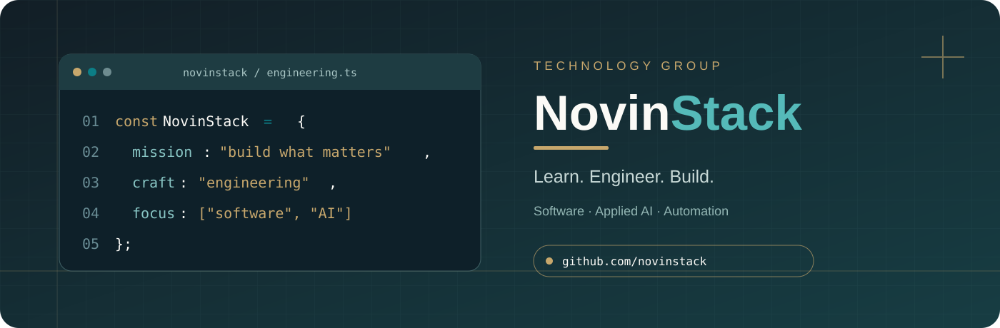
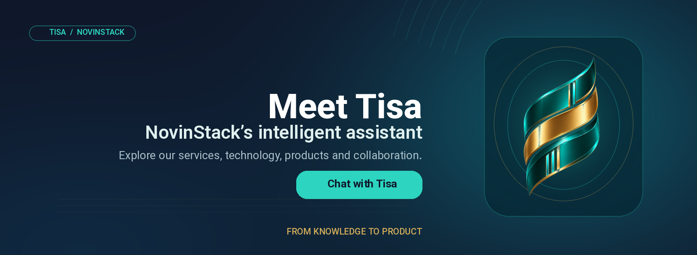
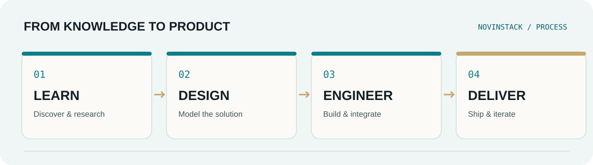

<h1 align="center">NovinStack | Software Engineering & Technology</h1>

<strong>NovinStack Technology Group</strong> From Knowledge to Product · از یادگیری تا ساخت محصول

  <a href="./README.md"><strong>🇮🇷 فارسی</strong></a> &nbsp;·&nbsp; <strong>🇬🇧 English</strong>

  <a href="https://novinstack.com">Website</a> &nbsp;·&nbsp;
  <a href="https://github.com/novinstack?tab=repositories">Repositories</a> &nbsp;·&nbsp;
  <a href="https://www.linkedin.com/company/novinstack/">LinkedIn</a> &nbsp;·&nbsp;
  <a href="https://www.instagram.com/novinstack/">Instagram</a> &nbsp;·&nbsp;
  <a href="https://t.me/novinstack">Telegram</a> &nbsp;·&nbsp;
  <a href="https://www.youtube.com/@NovinStack">YouTube</a>

---

## About NovinStack

**NovinStack** is a **software engineering and technology group** focused on **custom software development, web applications, enterprise systems, applied artificial intelligence, AI agents, business automation, and digital products**.

We work from understanding the problem and selecting an appropriate architecture through building, delivering, and improving reliable software. Our goal is to turn knowledge and ideas into useful, maintainable products—not simply to assemble technology stacks.

We are known as **NovinStack** (also written **Novin Stack**) and in Persian as **نوین‌استک** (نوین استک).

**Our philosophy:** *Structured Prestige* — disciplined engineering, purposeful simplicity, and lasting quality.

<h2 dir="ltr" align="left">Meet Tisa — Your NovinStack AI Assistant</h2>

<strong>Tisa is NovinStack’s intelligent assistant, bringing the group’s ideas into action.</strong>

Ask Tisa about our software engineering services, applied AI, automation, technologies, public projects, and ways to collaborate. Tisa supports Persian and English and can direct you to the NovinStack team when a question needs a project-specific answer.

<strong><a href="https://novinstack.github.io/novinstack/">Start a conversation with Tisa →</a></strong> &nbsp;·&nbsp; <a href="https://novinstack.com/contact">Contact NovinStack</a>

## Our Engineering Mindset

**Analyze before building · Architect for the problem · Write maintainable code · Test critical paths · Deploy reliably · Improve continuously**

<h2 dir="ltr" align="left">Artificial Intelligence at NovinStack</h2>

<strong>Practical AI for better decisions, stronger engineering, and more useful products.</strong>

At NovinStack, AI is more than a showcase feature. We explore its role at two complementary levels: **improving internal engineering workflows** and **building intelligent capabilities for digital products and business operations**.

### AI in Our Engineering Workflow

Our approach includes targeted use of AI assistants and agents for research, requirements analysis, documentation, development support, code review, test planning, knowledge workflows, and automation. Sensitive outcomes require **human oversight, access controls, and quality checks**. AI supports engineering judgment; it does not replace accountability.

### Applied AI for Businesses

Depending on the problem and available data, solutions may involve **AI agents, conversational assistants, retrieval-augmented generation (RAG), semantic search, document intelligence, recommendation systems, intelligent matching, and workflow automation**. We prioritize measurable value, security, operational cost, and maintainability.

<h2 dir="ltr" align="left">AI-Powered Industrial Products</h2>

<strong>Connecting industrial expertise, structured data, and intelligent software.</strong>

One of NovinStack’s strategic product directions is **AI-enabled industrial software and platforms**, including the concept of a specialized industrial marketplace connecting buyers, sellers, and suppliers.

| Product direction | Potential capabilities |
| :--- | :--- |
| **Technical & semantic search** | Finding components and equipment by application, requirements, and technical specifications |
| **Intelligent matching** | Matching procurement needs with suitable products and suppliers |
| **Industrial document intelligence** | Extracting structured information from catalogs, datasheets, and quotation requests |
| **Decision support** | Supporting product comparisons, pricing analysis, and supplier recommendations using reliable data |

**Development status:** These are strategic directions and capabilities under consideration, **not announcements of launched or generally available industrial products**.

## What We Do

| Area | Capabilities |
| :--- | :--- |
| **Software Engineering** | Custom software, websites and web applications, frontend and backend systems, APIs, service integrations |
| **Enterprise Systems** | Admin panels, dashboards, access control, ordering and supplier management, reporting |
| **Applied AI** | AI agents, conversational assistants, RAG, semantic search, document intelligence, and data-driven features |
| **Business Automation** | Workflows, n8n, bots, webhooks, connected services, and reducing repetitive manual processes |
| **Mobile & Desktop** | Android and cross-platform applications, Windows software, backend-integrated clients |
| **Digital & Industrial Products** | Product discovery, prototypes and MVPs, industrial platforms and marketplaces, maintainable architecture, iterative releases |
| **Education & Developer Tools** | Technical learning, documentation, developer utilities, and collaborative projects |

## Areas of the NovinStack Ecosystem

| Area | Focus |
| :--- | :--- |
| **Software** | Custom software engineering and systems development |
| **Automation** | Integrations, intelligent workflows, and practical AI |
| **Academy / Start** | Programming education and technology foundations |
| **Dev** | Software engineering, developer tooling, and technical content |
| **Growth** | Technical optimization, user experience, and digital growth |
| **Labs** | Research, experiments, prototypes, and MVPs |
| **Products** | Independent software products and digital solutions |

## Projects & Developer Tools

Browse our [**GitHub repositories**](https://github.com/novinstack?tab=repositories) for current public projects and developer tools. Selected projects can also be featured in the **Pinned** section of our GitHub profile—keeping this overview useful as the product portfolio grows.

**Release transparency:** Mentioning a focus area or research idea does not imply a corresponding product has already shipped.

  
<strong>Technology Stack &amp; Capabilities — expand</strong>

   
  <table width="100%">
    <thead><tr><th align="left">Layer</th><th align="left">Technologies and tools</th></tr></thead>
    <tbody>
      <tr><td><strong>Backend</strong></td><td>C#, .NET / ASP.NET Core, Node.js, PHP / Laravel, Python / FastAPI</td></tr>
      <tr><td><strong>Frontend</strong></td><td>TypeScript, JavaScript, React, Next.js, Vue, HTML, CSS, Tailwind CSS</td></tr>
      <tr><td><strong>Data</strong></td><td>SQL Server, PostgreSQL, MySQL, SQLite, MongoDB, Redis</td></tr>
      <tr><td><strong>Mobile &amp; Desktop</strong></td><td>Android, Kotlin, Flutter, .NET MAUI, WPF, WinForms</td></tr>
      <tr><td><strong>Infrastructure</strong></td><td>Git, GitHub, Docker, Nginx, Azure</td></tr>
      <tr><td><strong>Automation &amp; AI</strong></td><td>n8n, REST API, Webhooks, Telegram Bots, AI integrations</td></tr>
      <tr><td><strong>Additional</strong></td><td>WordPress, WooCommerce (when appropriate)</td></tr>
    </tbody>
  </table>
  
This reflects relevant capabilities and tools, not a claim that every technology is used in every project.

## Collaboration & Contact

For **software projects, technical collaboration, documentation, bug reports, or pull requests**, visit the relevant [repository](https://github.com/novinstack?tab=repositories). For business inquiries and consulting, visit [**novinstack.com**](https://novinstack.com).

**Security reports:** Please do not disclose vulnerabilities in public issues. Contact us privately through the [official contact page](https://novinstack.com/contact).

---

<strong>From Knowledge to Product</strong> NovinStack · Software Engineering · Applied AI · Automation · Digital Products

